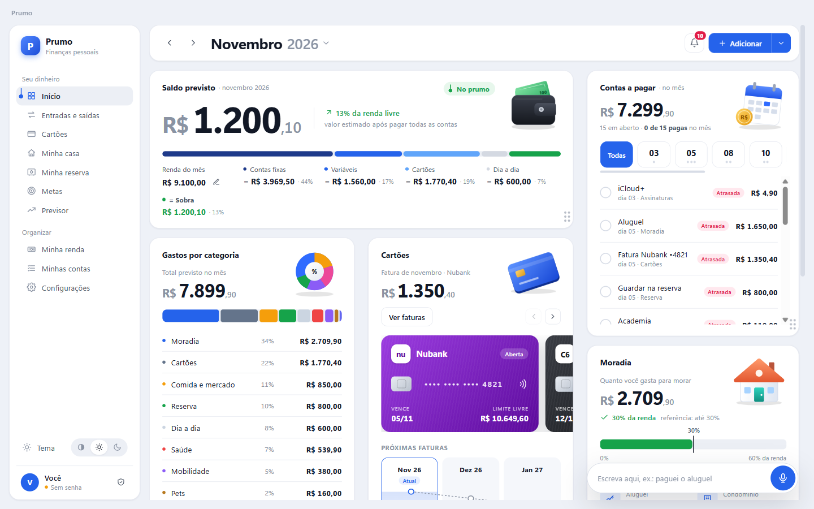
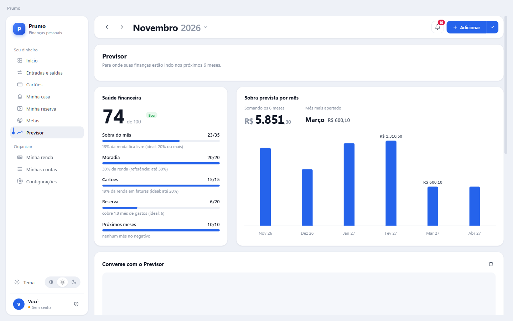
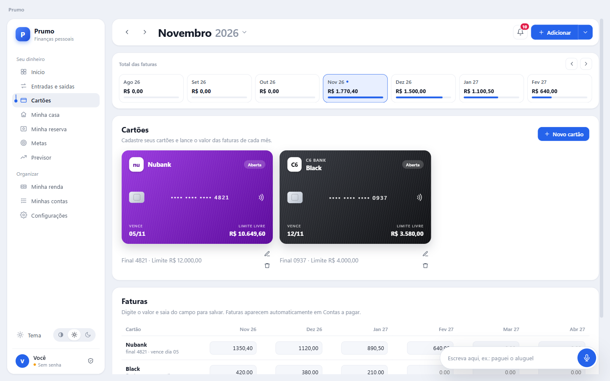
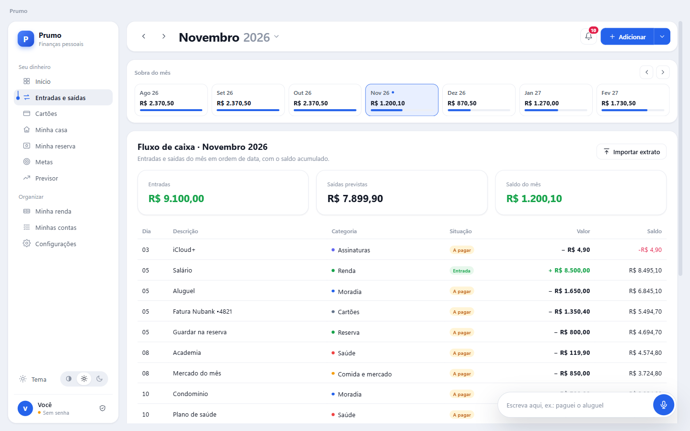
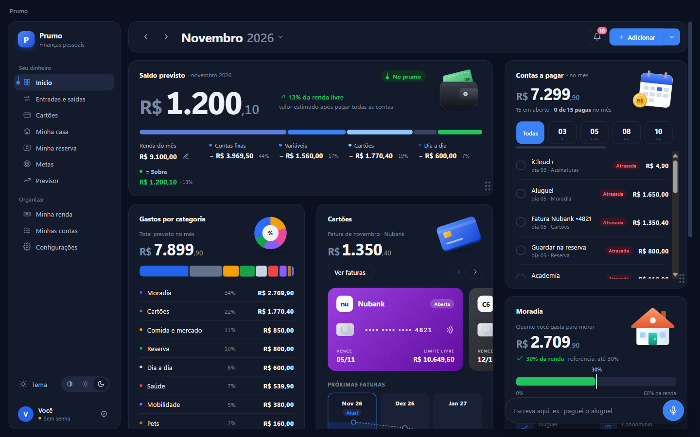

<p align="center">
  
</p>

<h1 align="center">Prumo</h1>

<p align="center">
  Finanças pessoais e da casa, no computador e no celular, sem depender da internet.
</p>

<p align="center">
  
  
  
  
  
</p>

<p align="center">
  
</p>

> [!NOTE]
> Este repositório é uma vitrine do projeto. O Prumo não tem versão pública para download, e o código não pode ser copiado nem reutilizado (veja [Licença](#licença)).

## Sobre

O Prumo nasceu de uma pergunta simples: **quanto vai sobrar no fim do mês depois de pagar tudo?** Em vez de só registrar o que já foi gasto, o app parte da renda, das contas fixas, das faturas dos cartões e do dia a dia para mostrar o saldo previsto do mês e dos próximos seis.

Os dados ficam só no aparelho. Não há conta, servidor nem sincronização em nuvem. Para levar os dados do computador para o celular (ou o contrário), basta exportar o arquivo de um lado e importar do outro.

## Funcionalidades

- **Visão geral do mês**: saldo previsto, quanto da renda fica livre, contas a pagar por dia de vencimento e gastos por categoria.
- **Cartões**: cadastro com as cores de 15 bancos brasileiros, faturas mês a mês e limite livre.
- **Assinaturas**: streaming, música, nuvem e afins, com o custo por mês e por ano e a próxima cobrança de cada uma. Podem ser pagas no cartão (entram na fatura) ou por Pix/boleto, e são reconhecidas ao importar o extrato.
- **Previsor**: nota de saúde financeira de 0 a 100, explicada item por item, e projeção da sobra nos próximos seis meses.
- **Minha casa**: contas divididas entre duas ou mais pessoas, com a parte justa de cada uma e quem deve devolver para quem.
- **Reserva e metas**: acompanhamento da reserva de emergência (em meses de gastos cobertos) e metas de economia com prazo.
- **Conversa por texto ou voz**: frases como *"gastei 30 no almoço"*, *"paguei o aluguel"* ou *"como fica fevereiro?"* viram lançamentos ou respostas com os números do app. Quando a frase é ambígua, o Prumo pergunta antes de alterar qualquer dado.
- **Importação de extratos**: arquivos PDF, OFX e CSV dos bancos e faturas de cartão. O Prumo reconhece cerca de 1.500 lojas e serviços do dia a dia (Uber, iFood, mercados, farmácias, escolas...) e já marca a categoria. Os lançamentos reconhecidos ficam separados dos que precisam de conferência, e o app lembra das escolhas feitas nos que ele não conhecia. Também reconhece contas já cadastradas e assinaturas. No Android, o extrato pode ser enviado direto de outro app pelo menu *Compartilhar*.
- **Avisos de vencimento**: resumo diário das contas que vencem nos próximos dias.
- **Tema claro, escuro ou automático**, acompanhando o sistema.

<table>
  <tr>
    <td></td>
    <td></td>
  </tr>
  <tr>
    <td></td>
    <td></td>
  </tr>
</table>

## Privacidade e segurança

- **Sem internet.** O app Android é gerado sem a permissão de rede, então o sistema bloqueia qualquer conexão. No computador, a janela só carrega arquivos locais.
- **Senha opcional com criptografia forte.** Com senha, os dados são cifrados com AES-256-GCM e a chave é derivada com scrypt. A senha nunca é gravada.
- **Fora do backup em nuvem.** No Android, os dados não entram no backup automático do Google.
- **Cópias locais automáticas.** Uma cópia por dia, guardando as últimas 14 e uma por mês dos últimos 12 meses.
- **Cartões sem dados sensíveis.** Só os quatro últimos dígitos são guardados, apenas para identificar o cartão.

## Como funciona por dentro

- **Uma interface, duas plataformas.** A mesma interface em HTML, CSS e JavaScript roda no Electron (Windows) e no Capacitor (Android). No celular, uma camada própria substitui o processo principal do Electron e mantém o mesmo formato de arquivo, para que um aparelho abra o que o outro exportou.
- **Entendimento de frases sem servidor.** A conversa usa um classificador próprio, treinado com o script em `tools/`. Ele usa n-gramas de palavras e de letras com *feature hashing*, tem pesos quantizados em 8 bits e roda inteiro no aparelho. Valores e datas são extraídos por regras, e as respostas sempre usam os cálculos do app.
- **Extratos em PDF sem servidor.** O texto do PDF é lido no próprio aparelho com o [pdf.js](https://mozilla.github.io/pdf.js/) e montado em linhas. Regras próprias encontram data, descrição e valor, e uma lista de estabelecimentos (`src/merchants.js`) define a categoria. Os arquivos do pdf.js ficam em `src/vendor/` e não fazem parte do repositório.
- **Voz offline.** O reconhecimento de fala usa o [Vosk](https://alphacephei.com/vosk/) com um modelo em português que roda localmente.
- **Sem framework de interface.** A interface é JavaScript puro, com renderização por templates e CSS próprio, para manter o app leve e sem dependências em tempo de execução.

## Tecnologias

| Área | Ferramentas |
| --- | --- |
| Desktop | Electron, electron-builder (instalador NSIS) |
| Android | Capacitor 7, plugins nativos em Java |
| Interface | HTML, CSS e JavaScript, sem framework |
| Voz | Vosk (WebAssembly) |
| Extratos em PDF | pdf.js |
| Criptografia | Web Crypto (AES-256-GCM), scrypt |

## Estrutura do projeto

```text
prumo/
├── main.js              # processo principal do Electron: arquivos, criptografia e cópias
├── preload.js           # ponte segura entre a janela e o processo principal
├── secretary.js         # avisos de vencimento no Windows
├── src/                 # interface compartilhada entre Windows e Android
│   ├── app.js           # telas, cálculos e ações
│   ├── statement.js     # leitura de extratos PDF, OFX e CSV
│   ├── merchants.js     # lojas e serviços conhecidos, por categoria
│   ├── intent.js        # classificador de frases
│   ├── voice*.js        # conversa e reconhecimento de voz
│   └── styles.css
├── mobile/
│   ├── web/             # camada do Android (arquivos, notificações, navegação)
│   ├── build-www.js     # monta a interface para o Capacitor
│   └── setup-android.js # ajustes do projeto nativo e plugins próprios
├── tools/               # dados e script de treino do classificador
└── docs/screenshots/
```

## Licença

Copyright © 2026 lucasmmalheiros. Todos os direitos reservados.

O código está disponível só para leitura. Copiar, modificar, distribuir ou usar o código, o nome, a marca ou a identidade visual do Prumo, no todo ou em parte, depende de autorização por escrito. Veja o arquivo [LICENSE](LICENSE).
